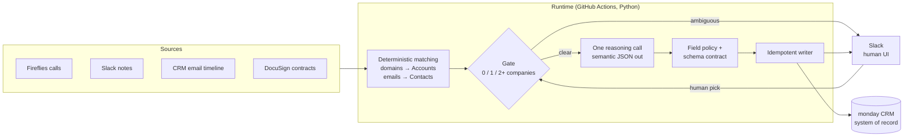

# GTM Runtime

**A CRM that updates itself from the conversations a firm already has.**

Sales teams lose deals in the gap between the call and the CRM. Notes never get
logged, follow-ups slip, and the pipeline report is fiction by Friday. This
runtime closes that gap. It listens to calls, emails, Slack threads and signed
contracts, then writes accurate, explainable updates into the CRM. No rep has to
type anything.

I designed and built it as the go-to-market operator at a GTM advisory firm,
where it ran the firm's pipeline. This public copy is sanitized: the firm
is renamed "Harbor Advisors," and all client, contact and workspace identifiers
are fictional.

## What it does

| Signal | What happens |
| --- | --- |
| **Recorded call** (Fireflies) | Matches the company and contacts. Posts a summary to Slack and waits for the rep's notes. Makes one model call, then writes Deal stage, pain, budget, next steps and owner-assigned tasks to the CRM. |
| **Unrecorded call** (`manual:` in Slack) | Free-text notes produce the same CRM updates and tasks as a recorded call. |
| **Email thread** (nightly) | Logs the narrative, closes tasks the email proves are done, and stamps last-touch dates. |
| **Stalled deal / unanswered follow-up** | Nudges the owner in Slack after 36 hours or two days. |
| **Signed contract** (DocuSign) | Reads the fees and scope from the executed SOW, marks the Deal *Won*, flips the Account to *Active Client*, files the PDF in the client's Drive folder, and opens onboarding. |
| **Weekly** | Mines Won/Lost deals for pricing, service and champion patterns and writes an advisory brief. |

Reps work in Slack. A ✅ reaction completes a task. Replies with `score:` or
`feedback:` grade the agent's output.

## How it's built

The design rule: **deterministic code everywhere, one bounded model call per
event.** Matching, gating, dedupe, writes and retries are plain code. The model
only turns messy text into structured fields, and it never touches an API
directly.



Each choice traces to a failure it prevents:

- **Fail closed on schema drift.** Every job compares the live CRM schema to a
  reviewed snapshot before it runs, so a renamed column can't corrupt data.
- **Field-level write policy.** Each CRM field declares who owns it and whether
  the agent may write it ([`docs/field-dictionary.md`](docs/field-dictionary.md)).
  The model proposes; policy decides.
- **Idempotent everything.** Content-hashed events and stored Slack timestamps
  make every job safe to re-run: no duplicate Deals, Updates, tasks or model
  calls.
- **Humans resolve ambiguity.** A call with two outside companies asks in Slack
  which one is the prospect. A contract matching more than one active Deal makes
  no changes at all.
- **Staged rollout.** New capabilities ship read-only, then run in shadow mode
  against real data, then go live behind explicit activation flags.
- **Cheap by design.** Reasoning runs on an open-weight model via OpenRouter,
  not per-seat CRM AI credits, and the CRM runs only its free automations.

## Build phases

The system shipped in six phases against a written PRD
([`docs/harbor-business-listening-agent-prd-v2.md`](docs/harbor-business-listening-agent-prd-v2.md)):

| Phase | Scope | Doc |
| --- | --- | --- |
| 0 | System inventory and ownership boundaries | [system-inventory-and-ownership](docs/system-inventory-and-ownership.md) |
| 1 | Shared event model and per-record narrative Updates | [phase-1](docs/phase-1-shared-event-and-narrative-foundation.md) |
| 2 | Email listening, task reconciliation, follow-up nudges | [phase-2](docs/phase-2-email-listening-activity-reconciliation-and-nudges.md) |
| 3 | Bounded business context from the CRM, Notion and Drive | [phase-3](docs/phase-3-business-context.md) |
| 4 | DocuSign contract finalization and client onboarding | [phase-4a](docs/phase-4-docusign-executed-contracts.md) · [phase-4b](docs/phase-4-docusign-client-onboarding.md) |
| 5 | Weekly win/loss pattern brief | [phase-5](docs/phase-5-portfolio-pattern-learning.md) |

## By the numbers

- **~17,000 lines** of Python runtime, plus **~7,500 lines** of tests
- **342 tests**, all offline and deterministic
- **8 scheduled workflows**: 15-minute call poller, nightly email and contract
  pass, daily task alerts, weekly context and pattern jobs, rollout supervisor
  and usage monitor
- **Integrations:** monday.com, Fireflies, Slack, DocuSign (JWT), Google Drive,
  Notion, OpenRouter

## Repository map

| Path | Contents |
| --- | --- |
| [`engine/runtime/`](engine/runtime) | Pollers, matching, gating, CRM client, writers, Slack loops |
| [`engine/matcher/`](engine/matcher) | Domain parsing and account matching |
| [`reasoning/`](reasoning) | Prompts, prompt builder, semantic-to-column writer, field and entity config |
| [`migrations/`](migrations) | One-time imports from Notion and Google Sheets |
| [`engine/tests/`](engine/tests) | Test suite |
| [`docs/`](docs) | PRD, phase specs, field dictionary, [operations guide](docs/OPERATIONS.md) |

## Run the tests

```bash
pip install -r engine/requirements.txt pytest
cd engine && python -m pytest -q
```

Running it live requires monday, Fireflies, Slack and OpenRouter credentials.
Setup and deployment are in [`docs/OPERATIONS.md`](docs/OPERATIONS.md).

---

Built by [Alex Mexicotte](https://twitter.com/AlexMexicotte).
